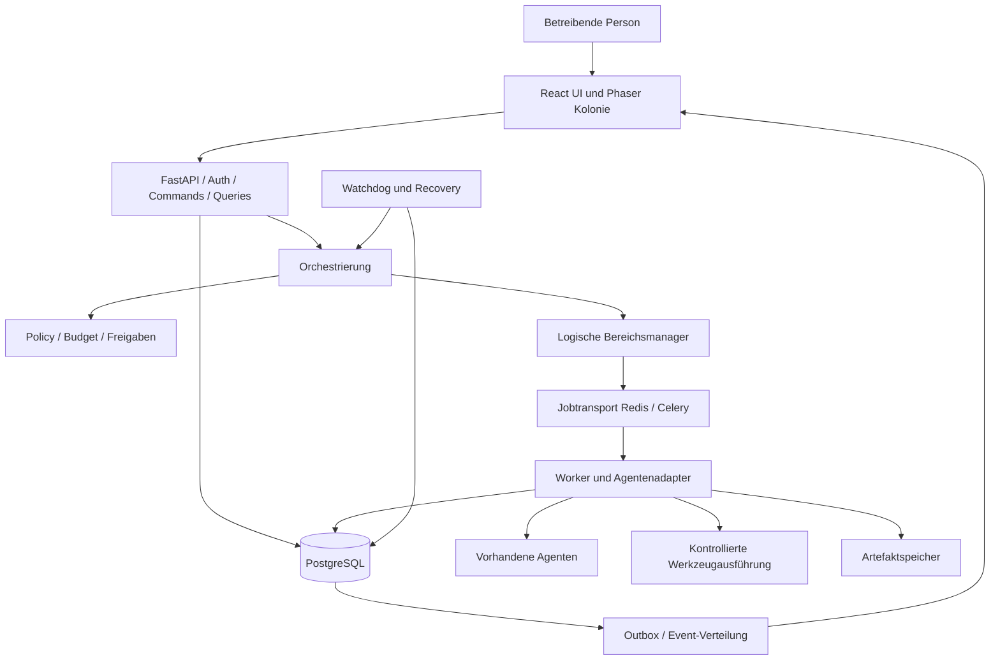

# Colony OS – Technische Projektübergabe

**Stand:** 15. Oktober 2026  
**Adressat:** Die implementierende KI des Ehemanns und die betreibende Person  
**Zweck:** Gemeinsame Grundlage für Bestandsaufnahme, Architekturentscheidungen und schrittweise Umsetzung  
**Status:** Produktanforderungen mit gekennzeichneten technischen Vorschlägen; keine Bestätigung einer vorhandenen Implementierung

## 1. Leseschlüssel und Verbindlichkeit

- **[BESCHLOSSEN]** bezeichnet Anforderungen aus dem aktuellen Auftrag und bestätigte gestalterische Wünsche.
- **[VORSCHLAG]** bezeichnet eine empfohlene Ausgestaltung. Diese darf nach Bestandsprüfung angepasst werden; relevante Abweichungen dokumentieren.
- **[OFFEN]** bezeichnet eine Entscheidung, für die Informationen oder eine Entscheidung der betreibenden Person fehlen.
- **[MVP-ZIEL]** bezeichnet einen vorgeschlagenen Umfang für die erste nutzbare Version, keine bereits bestätigte Priorisierung.

Die genannten Frameworks sind ausdrücklich **keine festgelegte Bestandstechnik**. Bestehende Agenten, Infrastruktur, Schnittstellen und Konventionen zuerst untersuchen. Funktionierende Komponenten möglichst über Adapter integrieren, statt sie vorschnell neu zu bauen.

Aus dem abrufbaren Gespräch sind folgende Stilwünsche bestätigt: isometrisch, gemütlich, hell, nicht steril, mehrere Ebenen und kleine Treppen sowie eine weniger überladene Darstellung. Die früheren Bildentwürfe und deren Assistentenerläuterungen waren nicht als auswertbare Inhalte verfügbar. Dieses Dokument beansprucht daher keine originalgetreue Rekonstruktion dieser Bilder. Zusätzliche technische Details stammen aus dem aktuellen Auftrag oder sind als Vorschlag gekennzeichnet.

## 2. Produktvision

**[BESCHLOSSEN]** Colony OS ist ein selbst gehostetes Dashboard für reale KI-Agenten. Eine bewohnte, isometrische Pixel-Art-Kolonie macht Aufgaben, Zuständigkeiten und Betriebszustände verständlich. Die Oberfläche ist gemütlich, hell und leicht verspielt, aber ruhig und übersichtlich.

Die Figuren repräsentieren tatsächliche registrierte Agenten. Räume zeigen Arbeitsbereiche, mehrere Etagen gliedern die Kolonie, kleine Treppen verbinden sie visuell. Hinter der Darstellung steht ein belastbares System für autonome Orchestrierung, Bereichsmanager, Aufgaben, Überwachung und kontrollierte Ausführung.

Die betreibende Person soll auf einen Blick beantworten können:

1. Welche Agenten arbeiten gerade woran?
2. Welche Aufgabe hängt, wartet auf Freigabe oder überschreitet ein Limit?
3. Welche Ergebnisse sind entstanden und wo liegen sie?
4. Was hat der Orchestrator entschieden und warum?
5. Wie lassen sich Arbeiten stoppen, freigeben oder nach einem Fehler fortsetzen?

**[VORSCHLAG]** Die Kolonie ist eine verständliche Darstellung des Betriebs, keine Spielsimulation mit eigenständiger Wahrheit. Animationen beeinflussen weder Aufgabenvergabe noch fachliche Zustände. Ein Agent muss nicht erst eine Treppe hinauflaufen, bevor sein Auftrag beginnen kann.

### 2.1 Abgrenzung

**[VORSCHLAG]** Zunächst kein autonomes System mit uneingeschränkten Rechten, kein vollständiger Ersatz vorhandener Agentenplattformen und kein Multiplayer-Aufbauspiel. Nicht im ersten MVP: freie Gebäudekonstruktion, komplexe Physik, Charakterbedürfnisse, öffentliche Benutzerregistrierung, Mandantenabrechnung oder ein eigener Modellserver.

**[BESCHLOSSEN]** Selbsthosting betrifft die Anwendung und ihre Betriebsdaten. **[OFFEN]** Ob ausschließlich lokale Modelle oder auch externe Modellanbieter verwendet werden dürfen, muss separat entschieden werden. Selbsthosting bedeutet nicht automatisch, dass keine Daten das eigene System verlassen.

## 3. Anforderungen

### 3.1 Funktionale Anforderungen

| ID | Status | Anforderung |
|---|---|---|
| F01 | BESCHLOSSEN | Reale Agenten registrieren und über Adapter anbinden. |
| F02 | BESCHLOSSEN | Zentrale autonome Orchestrierung mit delegierenden Bereichsmanagern. |
| F03 | BESCHLOSSEN | Tasks mit Zuständigkeit, Status, Ergebnis und nachvollziehbarem Verlauf verwalten. |
| F04 | BESCHLOSSEN | Watchdog, Heartbeats und Recovery vorsehen. |
| F05 | BESCHLOSSEN | Budgets, Freigaben und Sicherheitsgrenzen berücksichtigen. |
| F06 | BESCHLOSSEN | Events, Logs und Wissensmanagement integrieren. |
| F07 | BESCHLOSSEN | Agenten und Zustände in einer isometrischen Kolonie mit Räumen, Etagen und Treppen zeigen. |
| F08 | VORSCHLAG | Aufgaben erstellen, priorisieren, abbrechen und nach Prüfung erneut ausführen können. |
| F09 | VORSCHLAG | Agenten pausieren, isolieren und wieder aktivieren können. |
| F10 | VORSCHLAG | Freigaben, Fehler, Kosten und Ergebnisse aus der Kolonie direkt öffnen können. |
| F11 | VORSCHLAG | Eine gleichwertige Listenansicht für Bedienbarkeit und Barrierefreiheit anbieten. |

### 3.2 Qualitätsanforderungen

**[VORSCHLAG]**

- PostgreSQL hält die verbindlichen fachlichen Zustände. Browser, Queue und Animationen sind keine unabhängigen Wahrheitsquellen.
- Neustarts dürfen bestätigte Aufgaben, Freigaben und Ergebnisse nicht verlieren.
- Doppelt zugestellte Jobs und Events dürfen keine doppelten fachlichen Wirkungen auslösen.
- Jede relevante Entscheidung und externe Wirkung ist über eine durchgängige Kennung nachvollziehbar.
- Veraltete Verbindungen und unbekannte Zustände werden sichtbar angezeigt; keine vorgetäuschte Aktivität.
- Secrets erscheinen weder in Logs noch in Events, Wissenseinträgen oder Browserdaten.
- Ein Betreiber kann neue Ausführungen zentral stoppen und laufende Ausführungen bestmöglich abbrechen.
- Konfiguration, Datenexport sowie Backup und Wiederherstellung sind dokumentiert.
- **Vorläufiges Leistungsziel:** 20 sichtbare Agenten und 100 offene Tasks auf dem vereinbarten Zielgerät; sichtbare Statusänderung im lokalen Netz unter normaler Last innerhalb von zwei Sekunden nach Serverereignis. Das Zielgerät und das Messverfahren sind noch festzulegen.

## 4. Bestandsaufnahme vor Architekturbindung

**[BESCHLOSSEN]** Die konkrete Bestandstechnik zuerst prüfen. Keine bestehenden Agenten oder Workflows ohne belegten Grund ersetzen.

**[VORSCHLAG]** Als erstes ein kurzes Inventar erstellen:

| Prüffeld | Zu erfassende Informationen |
|---|---|
| Agenten | Namen, Aufgaben, Laufzeit, Framework, Start-/Stop-Verhalten, Parallelität |
| Schnittstellen | HTTP, CLI, SDK, WebSocket, Webhooks, Queue oder Dateiaustausch |
| Zuverlässigkeit | Job-IDs, Statusabfrage, Heartbeats, Timeouts, Abbruch, Wiederaufnahme, Idempotenz |
| Modelle | Anbieter, lokale Modelle, Kosteninformationen, Limits, Datenübertragung |
| Werkzeuge | Dateisystem, Git, Browser, Shell, externe Dienste und deren Berechtigungen |
| Infrastruktur | Betriebssystem, CPU/RAM/GPU, Docker, Netzwerk, Reverse Proxy, TLS |
| Daten | Bestehende Datenbanken, Artefakte, Wissensquellen, Backup und Aufbewahrung |
| Betrieb | Nutzerzahl, Anmeldung, LAN/VPN/Internet, Verfügbarkeitsbedarf |

Ergebnis: `docs/inventory.md`, ein Integrationsrisikoregister und kurze Architekturentscheidungen in `docs/adr/`. Geheimnisse nur als Referenzen erfassen, niemals als Werte. Nicht vorhandene Informationen ausdrücklich als unbekannt markieren.

## 5. Systemarchitektur

### 5.1 Vorgeschlagener Technologiezuschnitt

| Baustein | Status | Aufgabe und Begründung |
|---|---|---|
| React + TypeScript | VORSCHLAG | Bedienoberfläche, Listen, Formulare, Detailansichten und Einstellungen |
| Phaser | VORSCHLAG | Pixel-Art-Szene, Sprites, Kamera, Interaktion und Animation |
| FastAPI + Python | VORSCHLAG | API, Authentifizierung, Domänenlogik und Adaptersteuerung |
| PostgreSQL | VORSCHLAG | Persistente Aufgaben, Runs, Events, Freigaben und Wissen |
| Redis + Celery | VORSCHLAG | Jobtransport und Worker; konkrete Notwendigkeit nach Bestandsprüfung bewerten |
| LangGraph | OPTIONALER VORSCHLAG | Persistierbare, komplexere Agentenabläufe; erst bei belegtem Nutzen hinzufügen |
| Docker Compose | VORSCHLAG | Reproduzierbarer Betrieb auf einem einzelnen Host |

Keine konkreten Versionsnummern festlegen, bevor Kompatibilität und aktuelle Unterstützung geprüft wurden. Anschließend Abhängigkeiten und Container-Versionen reproduzierbar fixieren.

### 5.2 Komponenten und Datenfluss



**[VORSCHLAG]** Domänenzustand und Outbox-Ereignis in derselben Datenbanktransaktion speichern. Ein separater Dispatcher liefert Events und Jobs weiter. Dadurch kann ein Prozessabsturz zwischen Datenbankänderung und Versand nachgeholt werden.

Für den Browser REST für Befehle und Abfragen, zunächst Server-Sent Events für laufende Aktualisierungen verwenden. WebSocket ist eine Alternative bei echtem Bedarf an bidirektionalem Streaming. Nach Verbindungsabbruch aktuelle Zustände erneut laden; ein Event-Stream allein ersetzt keine Zustandsabfrage.

**[VORSCHLAG]** Zunächst modularer Backend-Monolith plus Worker und Watchdog. Bereichsmanager sind logische Rollen, keine zwingend separaten Dienste. Nicht jede Entscheidung benötigt einen Modellaufruf: Routing, Limits, Fristen und Wiederholungen möglichst deterministisch ausführen.

### 5.3 Adaptervertrag

Jeder Adapter beschreibt unterstützte Fähigkeiten und normalisiert fremde Agenten auf ein gemeinsames Protokoll:

```python
class AgentAdapter(Protocol):
    async def capabilities(self) -> AgentCapabilities: ...
    async def submit(self, request: RunRequest) -> RunHandle: ...
    async def status(self, handle: RunHandle) -> RunSnapshot: ...
    async def cancel(self, handle: RunHandle) -> CancelResult: ...
    async def health(self) -> HealthSnapshot: ...
```

**[VORSCHLAG]** `RunRequest` enthält Task-/Run-ID, stabile Idempotenzkennung, Inputreferenzen, Deadline, Budgetreservierung, erlaubte Werkzeuge und Policy-Version. Der Adapter speichert die externe Job-ID. Wiederaufnahme, Streaming, genaue Kosten und zuverlässiger Abbruch sind optionale Fähigkeiten und müssen explizit ausgewiesen werden.

Bei Agenten ohne Idempotenz oder Statusabfrage nach einem unklaren Timeout **nicht automatisch neu starten**. Den Run als ungeklärt behandeln, externe Wirkung prüfen und gegebenenfalls eine menschliche Entscheidung anfordern. Ein Adapter darf fehlende Garantien nicht vortäuschen.

## 6. Agentenrollen und Autonomie

| Rolle | Status | Verantwortung | Grenze |
|---|---|---|---|
| Zentraler Orchestrator | BESCHLOSSEN | Gesamtplanung, Delegation und Zusammenführung | Keine Umgehung von Policies, Freigaben oder Budgetlimits |
| Bereichsmanager | BESCHLOSSEN | Fachliche Zerlegung und Auswahl geeigneter Agenten | Keine eigenmächtige Ausweitung von Rechten oder Gesamtbudget |
| Arbeitsagenten | BESCHLOSSEN | Konkrete Tasks ausführen und Ergebnisse melden | Nur zugewiesener Kontext und erlaubte Werkzeuge |
| Watchdog | BESCHLOSSEN | Erreichbarkeit, Fortschritt, Fristen und Recovery überwachen | Keine beliebigen fachlichen oder externen Aktionen |
| Reviewer | VORSCHLAG | Ergebnisse anhand definierter Kriterien prüfen | Eigene Prüfung ersetzt keine erforderliche Betreiberfreigabe |
| Wissensverwaltung | VORSCHLAG | Quellen, Ergebnisse und Zusammenfassungen pflegen | Fremdinhalte dürfen keine Systemrechte verändern |

**[VORSCHLAG]** Beispielbereiche: Entwicklung, Recherche, Analyse und Betrieb. Die tatsächlichen Bereiche erst nach Inventar und realen Anwendungsfällen festlegen. Raum und Bereich sind nicht zwangsläufig identisch; die Raumzuordnung ist konfigurierbar.

### 6.1 Autonomer Ablauf

1. Auftrag mit Ziel, Inputs, Erfolgskriterien und Budget anlegen.
2. Orchestrator entwirft einen begrenzten Plan und Abhängigkeiten.
3. Policy-Schicht prüft Fähigkeiten, Datenzugriff, Budget und Freigabebedarf.
4. Bereichsmanager weist ausführbare Teilaufgaben zu.
5. Worker beansprucht den Auftrag mit zeitlich begrenzter Lease und startet den Adapter.
6. Heartbeats, Fortschritt, Ergebnisse und Kosten werden gespeichert.
7. Prüfung validiert Ergebnisse gegen explizite Erfolgskriterien.
8. Orchestrator führt Ergebnisse zusammen oder erstellt begrenzte Nacharbeit.
9. Ergebnis, Artefakte und relevante Erkenntnisse werden referenziert und angezeigt.

**[VORSCHLAG]** Schleifen durch maximale Planungstiefe, Zahl der Teilaufgaben, Versuche, Laufzeit und Kosten begrenzen. Ein Orchestrator darf seine eigenen Limits nicht erhöhen. Zieländerungen während einer Ausführung als neue Revision erfassen und abhängige Freigaben erneut prüfen.

## 7. Datenmodell

**[VORSCHLAG]** UUIDs als IDs, Zeitpunkte intern in UTC, Anzeige in der konfigurierten Benutzerzeitzone. Mutable Datensätze erhalten eine Versionsnummer für konkurrierende Änderungen. Fachliche Beziehungen über Fremdschlüssel und relevante Eindeutigkeit über Datenbankconstraints absichern.

| Entität | Wesentliche Felder / Beziehungen |
|---|---|
| `users`, `roles` | Identität, Rolle, Aktivstatus; keine Passwortklartexte |
| `areas` | Name, Manager-Zuordnung, fachliche Fähigkeiten |
| `rooms` | Bereich, Etage, Rasterposition, Darstellungsparameter |
| `agents` | Name, Adaptertyp, externe Referenz, Fähigkeiten, Raum, gewünschter Betriebszustand |
| `agent_health` | Agent, letzter Heartbeat, letzter Fortschritt, Gesundheitszustand |
| `tasks` | Ziel, Inputreferenzen, Erfolgskriterien, Bereich, Priorität, Status, Parent, Revision |
| `task_dependencies` | Vorgänger/Nachfolger; Zyklen verhindern |
| `runs` | Task, Versuch, Agent, externe Job-ID, Status, Start/Ende, Deadline, Fehlerklasse |
| `run_leases` | Run, Besitzer, Ablaufzeit, monotoner Fencing-Token |
| `checkpoints` | Run, Adapterreferenz, Schema-/Codeversion, Wiederaufnahmefähigkeit |
| `approvals` | Aktion und Payload-Hash, Antragsteller, Entscheider, Status, Ablauf, Policy-Version |
| `budgets` | Scope, Währung/Einheit, Zeitraum, Limit, Verhalten am Limit |
| `budget_ledger` | Reservierung, Verbrauch, Freigabe oder Korrektur; Run-/Providerreferenz |
| `events` | Ereignishülle und freigegebener Payload; unveränderlicher fachlicher Verlauf |
| `outbox` | Event-/Jobreferenz, Versandstatus, nächster Versuch |
| `artifacts` | Run, Speicherreferenz, Typ, Größe, Prüfsumme, Zugriffsbereich |
| `knowledge_items` | Inhalt/Referenz, Quelle, Autor/Agent, Version, Vertrauensstufe, Rechte |
| `knowledge_links` | Beziehungen zwischen Quellen, Tasks, Ergebnissen und Wissenseinträgen |
| `audit_entries` | Wer, was, wann, Zielobjekt, Policyentscheidung, Ergebnis |

### 7.1 Wichtige Invarianten

- Ein Task kann mehrere historische Runs haben, aber im MVP höchstens einen gleichzeitig aktiven Run.
- Eindeutige Kennungen verhindern doppelte Verarbeitung derselben Anfrage oder desselben Run-Starts.
- Ein verlorener Worker darf mit einer alten Lease keine neuen gültigen Zustandsänderungen schreiben. Fencing-Token beim Schreiben prüfen; für externe Aktionen zusätzlich wirksame Adapter-/Gatewaykontrollen verwenden.
- `succeeded` setzt ein gespeichertes Ergebnis und bestandene erforderliche Validierung voraus.
- Freigaben gelten für eine konkrete Aktion mit unverändertem Inhalt und begrenzter Gültigkeit.
- Budgetreservierungen und tatsächlicher Verbrauch werden getrennt geführt; erneute Kostenmeldungen dürfen nicht doppelt zählen.
- Fehlerdetails, umfangreiche Outputs und Artefakte nicht unkontrolliert in Statuszeilen oder Eventpayloads speichern.

## 8. Events, API und Statusmaschinen

### 8.1 Ereignisvertrag

**[VORSCHLAG]** Mindestens einmal zustellen und Konsumenten idempotent machen. Keine allgemeine Exactly-once-Garantie behaupten. Ereignisse sind Fakten; Befehle sind getrennte, autorisierte Änderungsanfragen.

```json
{
  "event_id": "uuid",
  "type": "run.progress_reported",
  "schema_version": 1,
  "occurred_at": "2026-10-15T10:00:00Z",
  "aggregate_type": "run",
  "aggregate_id": "uuid",
  "aggregate_version": 7,
  "correlation_id": "uuid",
  "causation_id": "uuid",
  "actor": {"type": "agent", "id": "uuid"},
  "payload": {"task_id": "uuid", "phase": "validating"}
}
```

Eventtypen: `task.created`, `task.status_changed`, `run.started`, `run.progress_reported`, `run.succeeded`, `run.failed`, `run.cancellation_requested`, `agent.heartbeat_received`, `agent.health_changed`, `approval.requested`, `approval.resolved`, `budget.threshold_reached`, `recovery.scheduled`, `artifact.created`, `knowledge.updated`.

Pro Aggregat Versionsreihenfolge prüfen; keine globale Reihenfolge über alle Agenten voraussetzen. Doppelte Events über `event_id` erkennen. Bei Lücken Snapshot laden. Heartbeats kompakt speichern oder verdichten, damit sie den fachlichen Verlauf nicht überfluten. Events nur nach Autorisierung an den Browser weiterreichen.

### 8.2 Taskzustände

**[VORSCHLAG]**

| Zustand | Bedeutung | Typische Folgezustände |
|---|---|---|
| `draft` | Auftrag noch unvollständig | `queued`, `cancelled` |
| `queued` | Vollständig, wartet auf Planung/Zuteilung | `blocked`, `awaiting_approval`, `running`, `cancelled` |
| `blocked` | Wartet auf Abhängigkeit, Ressource oder Budget | `queued`, `cancelled`, `failed` |
| `awaiting_approval` | Konkrete Entscheidung steht aus | `queued`, `running`, `failed`, `cancelled` |
| `running` | Ein Run arbeitet | `awaiting_approval`, `validating`, `retry_wait`, `failed`, `cancelling` |
| `validating` | Ergebnis wird geprüft | `succeeded`, `retry_wait`, `failed`, `cancelling` |
| `retry_wait` | Wiederholung nach Backoff vorgesehen | `queued`, `failed`, `cancelled` |
| `cancelling` | Abbruch angefordert, Wirkung noch nicht bestätigt | `cancelled`, `failed`, `succeeded` |
| `succeeded` | Erfolg bestätigt | Terminal |
| `failed` | Endgültig fehlgeschlagen | Terminal |
| `cancelled` | Abbruch bestätigt bzw. noch kein Run gestartet | Terminal |

Terminale Tasks nicht rückwirkend umschreiben. Eine manuelle Wiederholung erzeugt einen verknüpften neuen Task. Automatische Wiederholungen vor endgültigem Fehlschlag erzeugen weitere Runs desselben Tasks. Jede Transition erhält Grund, Actor und Zeitstempel.

`cancelling → succeeded` ist nur zulässig, wenn der Run vor wirksamem Abbruch nachweislich erfolgreich endete; den Abbruchwettlauf im Verlauf sichtbar machen. Eine Ablehnung beendet die angefragte Aktion; ob der Task scheitert oder neu geplant wird, bestimmt eine explizite Policy. Keine verdeckte Umplanung zur Umgehung der Ablehnung.

### 8.3 Getrennte Betriebszustände

**[VORSCHLAG]** Taskzustand, Runzustand und Agentengesundheit getrennt halten:

- Run: `pending`, `starting`, `running`, `waiting_approval`, `validating`, `cancelling`, `succeeded`, `failed`, `cancelled`, `unknown`.
- Gewünschter Agentenbetrieb: `enabled`, `paused`, `quarantined`.
- Beobachtete Gesundheit: `healthy`, `suspect`, `offline`, `unknown`.
- Anzeigeaktivität wird daraus abgeleitet, beispielsweise verfügbar, arbeitet oder wartet.

`unknown` bedeutet fehlende Gewissheit über eine möglicherweise fortlaufende externe Ausführung. Der zugehörige Task wird mit klarem Grund blockiert, bis Reconciliation oder menschliche Prüfung den Zustand klärt. Eine laufende Animation ist kein Lebenszeichen.

### 8.4 API-Skizze

**[VORSCHLAG]** Versionierte API unter `/api/v1`:

| Endpunkt | Zweck |
|---|---|
| `GET /agents`, `GET /agents/{id}` | Agenten und beobachteter Zustand |
| `POST /agents/{id}/pause` | Neue Zuweisungen aussetzen |
| `POST /tasks`, `GET /tasks/{id}` | Auftrag anlegen bzw. Details lesen |
| `POST /tasks/{id}/cancel` | Kontrollierten Abbruch anfordern |
| `POST /tasks/{id}/retry` | Autorisierte manuelle Wiederholung anlegen |
| `GET /runs/{id}` | Ausführung, Kosten und Artefakte |
| `POST /approvals/{id}/resolve` | Konkrete Freigabeentscheidung |
| `GET /events/stream` | Autorisierte Live-Aktualisierungen |
| `GET /knowledge` | Zugriffsgeprüfte Wissenssuche |
| `POST /operations/emergency-stop` | Neue Ausführungen sperren und Abbruch anfordern |

Ändernde Anfragen erhalten Idempotenzkennung und gegebenenfalls erwartete Objektversion. Validierungsfehler, Rechtefehler und Versionskonflikte strukturiert zurückgeben. Keine beliebigen Shellbefehle über generische Browserendpunkte akzeptieren.

## 9. Watchdog, Heartbeats und Recovery

**[BESCHLOSSEN]** Diese Funktionen gehören zur Betriebsarchitektur. **[VORSCHLAG]** Initiale, pro Adapter konfigurierbare Werte:

| Signal | Startwert | Reaktion |
|---|---|---|
| Worker-Heartbeat | alle 15 Sekunden | Beobachtete Erreichbarkeit aktualisieren |
| Kein Heartbeat | nach 45 Sekunden | `suspect`; Warnung und Statusabfrage |
| Weiterhin kein Heartbeat | nach 90 Sekunden | `offline`; Reconciliation, keine blinde Doppelvergabe |
| Lease | 60 Sekunden, Verlängerung alle 15 Sekunden | Schreibberechtigung nur für aktuellen Besitzer |
| Kein fachlicher Fortschritt | aufgabenspezifisch, z. B. 5 Minuten | Prüfen, ob blockiert, langlaufend oder festgefahren |
| Harte Deadline | je Task/Run | Abbruch anfordern und tatsächliches Ende prüfen |
| Transienter Fehler | höchstens 3 Versuche insgesamt | Exponentieller Backoff mit Zufallsanteil |

Heartbeat des Adapters und Lebenszeichen des entfernten Agenten unterscheiden. Ein lebender Worker beweist nicht, dass sein externer Job Fortschritt macht. Lange legitime Schritte benötigen eine passende Deadline statt eines allgemeinen kurzen Fortschrittstimeouts.

### 9.1 Recovery-Reihenfolge

1. Letzten persistenten Zustand, Lease und externe Job-ID lesen.
2. Über den Adapter prüfen, ob die externe Ausführung noch läuft oder bereits beendet ist.
3. Ergebnis und Kosten abgleichen; bereits abgeschlossene Arbeit übernehmen.
4. Bei sicher fortsetzbarem Checkpoint mit kompatiblem Schema wieder aufnehmen.
5. Nur bei nachweislich sicherer Wiederholung einen neuen Run starten.
6. Bei unklaren externen Wirkungen Task blockieren und Prüfung anfordern.

Nach Hostneustart aktive Runs zuerst abgleichen. Permanenten Fehler, Sicherheitsverstoß oder fehlende Berechtigung nicht automatisch wiederholen. Wiederholte Adapterfehler lösen einen Circuit Breaker bzw. Quarantäne aus. Recovery-Versuche verbrauchen ebenfalls Budget und Versuchslimits.

## 10. Budget und Freigaben

### 10.1 Budgetkontrolle

**[VORSCHLAG]** Limits pro Run, Task, Bereich und globalem Zeitraum; zunächst eine Basiswährung und zusätzlich Token-/Laufzeitgrenzen. Währungsumrechnung erst nach expliziter Entscheidung ergänzen.

- Vor dem Start erwarteten maximalen Verbrauch atomar reservieren. Alle übergeordneten Limits prüfen, damit parallele Starts nicht gemeinsam das Restbudget verbrauchen.
- Tatsächliche Nutzung nachführen und Reservierungen beim Abschluss abgleichen.
- Unbekannte Kosten sichtbar als Schätzung führen; unbekannt bedeutet nicht kostenlos.
- Bei fehlenden belastbaren Anbieterlimits konservative lokale Grenzen setzen oder Ausführung blockieren.
- Warnschwellen vorschlagen: 70 % und 90 %. Bei ausgeschöpftem Budget keine neuen kostenpflichtigen Schritte beginnen.
- Bereits laufende Anbieteraufrufe können nach einem Stopp noch Kosten verursachen. Anzeige muss diesen möglichen Nachlauf berücksichtigen; eine centgenaue harte Obergrenze ist nur mit entsprechender Anbieterunterstützung zusicherbar.
- Hängende Reservierungen erst nach Abgleich freigeben, nicht allein aufgrund eines abgelaufenen Heartbeats.

### 10.2 Freigabemodell

**[VORSCHLAG]** Freigabepflicht nach Wirkung und Risiko, nicht allein nach Agentenname. Beispiele:

| Aktion | Vorgeschlagene Standardpolicy |
|---|---|
| Lesen freigegebener lokaler Quellen | Innerhalb vorhandener Rechte autonom |
| Schreiben im isolierten Taskarbeitsverzeichnis | Autonom, protokolliert |
| Externe Nachricht, Veröffentlichung oder Deployment | Vorherige konkrete Freigabe |
| Löschen produktiver Daten oder irreversible Änderung | Vorherige konkrete Freigabe mit Auswirkungsbeschreibung |
| Budgeterhöhung oder Rechteerweiterung | Ausschließlich autorisierte betreibende Person |

Eine Freigabe enthält Zielsystem, genaue Aktion, relevante Inhalte, Auswirkungen, Kostenrahmen, Ablaufzeit und Payload-Hash. Veränderte Inhalte benötigen eine neue Freigabe. Entscheidung und tatsächliche Ausführung getrennt auditieren; kurz vor Ausführung Gültigkeit und Policy erneut prüfen. Freigaben einmalig atomar beanspruchen. Wiederholte externe Aktionen zusätzlich mit Idempotenz absichern.

Vorab erteilte Autorisierung darf präzise, zeitlich und sachlich begrenzte Aktionsklassen abdecken. Pauschale Freigaben für beliebige spätere Aktionen vermeiden. Eine wartende Freigabe hält keinen Worker unnötig belegt: Zustand persistieren und bei Entscheidung kontrolliert fortsetzen.

## 11. Sicherheit

**[BESCHLOSSEN]** Sicherheit und kontrollierbare Autonomie sind Kernanforderungen. Die folgenden Mechanismen sind **[VORSCHLAG]** und vor produktiver Nutzung zu konkretisieren.

### 11.1 Vertrauensgrenzen

1. Browser → API: Anmeldung, Autorisierung und Eingabevalidierung.
2. Orchestrator → Worker: nur deklarierte Fähigkeiten und begrenzter Kontext.
3. Agent → Werkzeuge: serverseitige Policy-Prüfung und isolierte Ausführung.
4. Externe Inhalte → Wissen/Planung: nicht vertrauenswürdige Daten, keine neuen Anweisungsrechte.
5. Server → Modellanbieter: erlaubte Datenklassen, notwendiger Umfang und protokollierte Verbindung.

### 11.2 Mindestmaßnahmen

- Zunächst privater Zugriff über LAN/VPN; kein ungeprüftes öffentliches Deployment.
- Authentifizierung auch im Heimnetz. Rollen etwa Betreiber, Ausführender und Lesender; konkrete Kontenanzahl offen.
- Secrets außerhalb des Repositorys speichern, serverseitig auflösen und pro Adapter begrenzen. Browser und Modellprompts erhalten keine unnötigen Zugangsdaten.
- Werkzeugzugriffe auf erlaubte Pfade, Domains und Aktionen begrenzen. Ausführung bevorzugt in isolierten Containern mit minimalen Rechten und Ressourcenlimits.
- Keinen Docker-Socket oder uneingeschränkten Hostzugriff in Agentencontainer geben. Ein Docker-Container allein ist keine ausreichende Sicherheitsgrenze für beliebig feindlichen Code.
- Policy-Prüfung für jede wirksame Werkzeugaktion, nicht nur beim Start. Wenn ein vorhandener Agent dies nicht unterstützt, Integration entsprechend einschränken oder stärker isolieren.
- SSRF-Schutz für vom Agenten gelieferte URLs: interne/metadatenbezogene Adressen und Umleitungen berücksichtigen; freigegebene interne Ziele ausdrücklich konfigurieren.
- Dateipfade kanonisieren und gegen erlaubte Wurzeln prüfen; Traversal und Symlink-Ausbrüche berücksichtigen.
- HTML/Markdown-Ausgaben bereinigen; Artefakte sicher ausliefern. Cookiebasierte Sessions benötigen CSRF-Schutz; sichere Cookies und konkrete CORS-Allowlist einsetzen.
- Prompts, Webseiten und Wissenseinträge können manipulierte Anweisungen enthalten. Sie dürfen weder Freigaben ausstellen noch Policies ändern. Auf Promptdisziplin allein ist kein Sicherheitskonzept zu bauen.
- Logs und Events redigieren, Zugriffe prüfen und Aufbewahrungsfristen festlegen.
- Abhängigkeiten prüfen, Image-Versionen fixieren und Backups verschlüsseln, soweit sensible Daten betroffen sind.

### 11.3 Not-Aus

**[VORSCHLAG]** Ein globaler Not-Aus sperrt sofort neue Zuweisungen und Werkzeugaktionen, sendet Abbruch an laufende Runs und zeigt unbestätigte Abbrüche deutlich an. Bereits ausgelöste externe Wirkungen können nicht generell rückgängig gemacht werden. Wiederfreigabe ausschließlich durch die berechtigte betreibende Person, mit dokumentiertem Grund.

## 12. Logs, Beobachtbarkeit und Wissensmanagement

### 12.1 Betriebsdaten

**[VORSCHLAG]** Drei getrennte Zwecke:

- **Events:** fachliche Zustandsänderungen für UI und Ablaufsteuerung.
- **Logs/Metriken:** technische Diagnose, Laufzeiten, Queuealter, Fehler und Adapterzustand.
- **Audit:** sicherheitsrelevante Aktionen, Freigaben, Rechte- und Budgetänderungen.

Alle verwenden Task-, Run- und Korrelationskennungen. Standardmäßig keine vollständigen Prompts oder Rohoutputs loggen. Diagnosemodus nur zeitlich begrenzt und mit Redaktion. Auditdaten vor Änderungen durch Arbeitsagenten schützen; eine gewöhnliche Datenbanktabelle ist nicht automatisch manipulationssicher gegenüber Administratoren.

Dashboard-Kennzahlen: aktive/blockierte Tasks, ältester wartender Task, Agentengesundheit, fehlende Heartbeats, Fehlerrate, Recovery-Versuche, Budgetreservierung/-verbrauch, offene Freigaben und Eventverzögerung. Warnungen deduplizieren und nach Behebung auflösen. Benachrichtigungskanäle bleiben offen; im MVP genügt eine sichtbare In-App-Inbox.

### 12.2 Wissen

**[BESCHLOSSEN]** Wissensmanagement integrieren. **[VORSCHLAG]** Mit versionierten Einträgen, Quellenverweisen und PostgreSQL-Volltextsuche beginnen. Vektorsuche erst hinzufügen, wenn reale Suchfälle sie rechtfertigen.

- Rohquelle, Agentenzusammenfassung und menschlich bestätigte Erkenntnis unterscheiden.
- Herkunft, Erstellzeit, Aktualität, Vertrauensstufe und zugrunde liegende Tasks mitführen.
- Temporären Run-Kontext nicht automatisch als dauerhafte Wahrheit speichern.
- Widersprüche und neue Versionen sichtbar halten; alte Aussagen nicht still überschreiben.
- Zugriff schon bei Suche/Retrieval filtern, nicht erst nach der Antwortgenerierung.
- Geheimnisse ausschließen; Löschung und Aufbewahrung auch auf Indizes und abgeleitete Kopien anwenden.
- Wissensübernahme und Wiederverwendung über Quellenreferenzen im Ergebnis nachvollziehbar machen.

## 13. Oberfläche, Pixel-Art und Animationen

### 13.1 Beschlossene Stilrichtung

**[BESCHLOSSEN]**

- Isometrische Pixel-Art mit mehreren Etagen und kleinen Treppen.
- Helle, warme und gemütliche Atmosphäre.
- Leicht verspielt, bewohnt und freundlich; nicht steril.
- Weniger überladen: wenige gezielte Möbel und Dekorationen, klare Raumgrenzen und freie Sicht auf Figuren.
- Figuren stehen für reale Agenten und zeigen deren Arbeit verständlich.

### 13.2 Vorgeschlagene Gestaltung

**[VORSCHLAG]** Warme Creme- und Holztöne, sanfte Grün-/Blauakzente, ruhige Schatten. Charakter durch einzelne Pflanzen, Lampen oder Teppiche statt durch viele Kleinteile. Keine Neon-Kommandozentrale. Der Projektname legt keine Verwendung geschützter Filmfiguren nahe; eigenständige Figuren gestalten und Assetrechte dokumentieren.

Für den MVP zwei versetzte Ebenen mit einer kurzen Treppe, drei bis vier Räumen und wenigen Figuren. Eine Etagenansicht bzw. Ausblendung verhindert Verdeckung. Etagen können visuelle Bereiche strukturieren, ohne reale Infrastruktur vorzutäuschen.

### 13.3 Bedienung

- Mitte: Kolonie mit Zoom, Verschieben, Etagenfilter und „Ansicht zurücksetzen“.
- Oben: Gesamtzustand, aktive Tasks, Budget und offene Freigaben.
- Seitlich: Detailpanel für gewählten Agenten, Raum oder Task.
- Ergänzend: Aufgabenliste, Ereignisverlauf, Wissen, Einstellungen und Bedienung des Not-Aus.
- Agent anklicken: Rolle, tatsächlicher Status, aktuelle Aufgabe, letzter Heartbeat, Fortschritt, Kosten und Ergebnisreferenzen.
- Raum anklicken: Bereich, zuständiger Manager, Agenten und anstehende Aufgaben.
- Fehler und Freigaben bleiben auffindbar, auch wenn die zugehörige Figur verdeckt oder ausgefiltert ist.

React rendert lesbare Texte und zugängliche Bedienelemente. Phaser rendert die Szene. Beide verwenden denselben vom Backend abgeleiteten Zustand. Keine fachlichen Übergänge durch Animationscallbacks auslösen.

### 13.4 Visuelle Statuszuordnung

| Fachliche Situation | Vorgeschlagene Darstellung |
|---|---|
| Verfügbar | Ruhige Idle-Animation am Platz |
| Arbeitet | Kleine Arbeitsbewegung mit dauerhaftem Statussymbol |
| Wartet auf Abhängigkeit | Pausierende Figur und erklärender Hinweis |
| Wartet auf Freigabe | Klares Freigabesymbol und Inboxeintrag |
| Fehler / Quarantäne | Zurückhaltendes Warnsymbol mit Text |
| Offline / unbekannt | Entsättigung und Kennzeichnung, kein fingiertes Arbeiten |
| Aufgabe erfolgreich | Kurze, dezente Bestätigung; Ergebnis bleibt im Verlauf |

Farbe nie als einziges Signal verwenden. „Bewegung reduzieren“, Tastaturbedienung und eine semantische Listenansicht vorsehen. Normale Schrift für Daten und längere Texte; Pixelschrift höchstens für kurze dekorative Titel.

### 13.5 Asset-Pipeline

**[VORSCHLAG]** Erst eine kleine Stilprobe abnehmen, danach weitere Assets erstellen:

1. Ein Raum, eine Figur, eine Treppe und zwei Etagen in einer gemeinsamen Testszene.
2. Raster und Skalierung festlegen, beispielsweise isometrische Bodenkacheln von 64 × 32 Pixeln; endgültiges Maß offen.
3. Einheitliche Perspektive, Lichtquelle, Palette, Pixelgröße und transparente Hintergründe festlegen.
4. Spritesheets mit festen Framegrößen, Pivotpunkten, Richtungen und Animationsnamen dokumentieren.
5. Tiefensortierung, Etagenhöhe, Auswahlflächen und Verdeckung in der Szene prüfen.
6. Assets mit Quelle, Lizenz und Bearbeitungshinweisen in einem Manifest erfassen.

MVP-Assets: Boden/Wände, kleine Treppe, Arbeitsplatz, Lampe/Pflanze, wenige eigenständige Figuren, Statussymbole. Animationen zunächst `idle`, `work`, `walk` und kurze Erfolgsreaktion. Etagenwechsel darf eine einfache Animation sein. Komplexe Wegfindung und viele Blickrichtungen später ergänzen.

KI-generierte Pixel-Art ist eine mögliche Quelle, aber keine garantierte fertige Spritesheet-Pipeline. Konsistenz, Transparenz, Frameausrichtung, Pixelraster und Lizenzbedingungen vor Übernahme prüfen. Zunächst Platzhalter verwenden, bis Laufzeitintegration funktioniert.

## 14. MVP-Phasen und Akzeptanzkriterien

Alle Phasen sind **[VORSCHLAG]**. Reihenfolge bewusst: Bestandsprüfung → echter vertikaler Ablauf → Betriebsrobustheit → visuelle Ausarbeitung. Keine feste Zeitplanung ohne Kenntnis der Infrastruktur.

| Phase | Lieferumfang | Abnahme / Nachweis |
|---|---|---|
| 0 – Inventar und Entscheidungen | Bestand, Adapterauswahl, Hosting, Sicherheitsgrenzen, ADRs | Ein vorhandener Agent oder seine dokumentierte Schnittstelle ist untersucht; Unbekanntes und Grenzen sind benannt. |
| 1 – Vertikaler Durchstich | API, Datenbank, Task/Run, Adapter, einfache Listenansicht | Ein realer Agent bearbeitet einen sicheren Testauftrag; Task, Run, Ergebnis und Verlauf bleiben nach Neustart erhalten. Ein Simulator allein erfüllt die Abnahme nicht. |
| 2 – Kontrollierte Orchestrierung | Zentraler Planer, ein Bereichsmanager, Abhängigkeiten, Freigaben, Budget | Ein Auftrag wird begrenzt zerlegt; blockierte Tasks starten nicht; eine freigabepflichtige Aktion wartet; parallele Starts überschreiten das reservierbare Limit nicht. |
| 3 – Robuster Betrieb | Heartbeats, Watchdog, Leases, Outbox, Recovery, Not-Aus | Workerabsturz und Queue-Doppelzustellung werden ohne doppelte sichere Wirkung behandelt; unklare externe Wirkung wird blockiert. Not-Aus verhindert neue Starts. |
| 4 – Kolonie-MVP | Zwei Ebenen, Treppe, wenige Räume, echte Agenten, Details, Live-Updates | Klick zeigt den richtigen Agenten/Task; Szene und Liste stimmen überein; Reconnect lädt korrekten Zustand; die Stilprobe erfüllt „hell, cozy, übersichtlich“. |
| 5 – Wissen und Betriebsübergabe | Quellenbasiertes Wissen, Artefakte, Backup, Restore, Runbook | Ergebnisse lassen sich über Quellen wiederfinden; Berechtigungen gelten auch für Suche; Wiederherstellung aus einem Backup ist erfolgreich demonstriert. |

### 14.1 Gesamtdefinition „MVP fertig“

- Mindestens ein tatsächlich vorhandener Agent arbeitet über einen geprüften Adapter; fehlende Adapterfähigkeiten sind sichtbar dokumentiert.
- Ein vollständiger Auftrag durchläuft Anlage, Zuteilung, Ausführung, Validierung und Ergebnisanzeige.
- Ein begrenzter Orchestrierungsfall nutzt einen Bereichsmanager und mindestens eine Abhängigkeit.
- Freigaben sind an konkrete Aktionen gebunden; abgelaufene oder veränderte Freigaben werden zurückgewiesen.
- Budgetprüfung funktioniert auch bei parallelen Starts; Schätzung und tatsächlicher Verbrauch sind unterscheidbar.
- Neustart, Verbindungsabbruch, doppelter Job, fehlender Heartbeat und unklarer Adaptertimeout wurden gezielt geprüft.
- Der Browser zeigt reale, aktuelle oder ausdrücklich veraltete Zustände; Demofiguren sind eindeutig als Demo markiert.
- Kolonie besitzt mehrere Ebenen und eine sichtbare kleine Treppe bei ruhiger Gestaltung.
- Kritische Aktionen sind autorisiert und auditiert; Testsecrets erscheinen nicht in Browser oder Logs.
- Installation, Betrieb, Not-Aus und Wiederherstellung sind für eine andere Person nachvollziehbar dokumentiert.

### 14.2 Zielgerichtete Verifikation

**[VORSCHLAG]** Domänentests für erlaubte/verbotene Zustandsübergänge, konkurrierende Budgetreservierung, Einmaligkeit von Freigaben und Leasewechsel. Adapter-Vertragstests für Erfolg, Fehler, Abbruch und unklaren Timeout. Integrationstests für Datenbank/Outbox/Worker sowie wenige vollständige UI-Abläufe. Sicherheitsprüfungen für Rechteüberschreitung, Pfadausbruch, manipulierte Inhalte und Secretredaktion. Visuelle Prüfung von Etagenverdeckung, Lesbarkeit und reduzierter Bewegung.

Tests sollen relevante Fehlerszenarien nachweisen, statt nur Implementierungsdetails nachzubauen. Keine echten kostenpflichtigen oder irreversiblen externen Wirkungen in automatisierten Tests; sichere Testziele verwenden.

## 15. Vorgeschlagene Projektstruktur

```text
colony-os/
├── README.md
├── .env.example                 # Nur Platzhalter, keine Geheimnisse
├── compose.yaml
├── docs/
│   ├── inventory.md
│   ├── architecture.md
│   ├── security.md
│   ├── operations.md
│   ├── asset-style-guide.md
│   └── adr/
├── frontend/
│   ├── src/
│   │   ├── api/
│   │   ├── state/
│   │   ├── components/
│   │   ├── pages/
│   │   └── colony/              # Phaser-Szenen und reine Darstellung
│   └── public/assets/
│       ├── manifest.json
│       ├── tiles/
│       ├── characters/
│       └── icons/
├── backend/
│   ├── app/
│   │   ├── api/
│   │   ├── domain/              # Zustände und Invarianten
│   │   ├── orchestration/
│   │   ├── policies/
│   │   ├── adapters/
│   │   ├── workers/
│   │   ├── watchdog/
│   │   ├── events/
│   │   ├── knowledge/
│   │   └── persistence/
│   ├── migrations/
│   └── tests/
├── contracts/                   # Event- und API-Schemata
├── tests/e2e/
└── ops/                         # Deployment- und Backup-Konfiguration
```

Vorhandene Repositorystruktur hat Vorrang, wenn sie sinnvoll passt. Domänenlogik nicht in UI-Szenen oder Adaptercode verstecken. Persistente Daten und Secrets liegen außerhalb des versionierten Quellcodes.

## 16. Deployment und Betriebsübergabe

**[VORSCHLAG]** Compose-Dienste: Frontend/Reverse Proxy, API, Worker, Watchdog/Scheduler, PostgreSQL und bei bestätigter Wahl Redis. Datenbank und Redis nicht öffentlich exponieren. Einen Scheduler aktiv betreiben bzw. Führung über Lease absichern, damit Watchdog-Jobs nicht mehrfach unkoordiniert laufen.

Persistente Volumes für Datenbank und Artefakte, Healthchecks, geordnete Migrationen, Ressourcenlimits und begrenzte Loggrößen vorsehen. Abhängige Dienste müssen Verbindungsabbrüche selbst vertragen; Startreihenfolge allein genügt nicht.

Backups erfassen Datenbank, Artefakte und nötige Konfiguration konsistent. Separate Sicherung der Secrets unter passenden Zugriffsrechten. **[OFFEN]** Backupintervall, Aufbewahrung sowie tolerierbarer Datenverlust und Wiederherstellungsdauer. Restore zunächst in isolierter Umgebung testen; aktive Runs dort nicht automatisch wieder mit externen Diensten verbinden. Nach Wiederherstellung Jobs und externe Wirkungen vor Fortsetzung abgleichen.

Runbook: Installation, Update, Migration, Rollbackgrenzen, Adapterausfall, Budgetstop, Not-Aus, Backup/Restore, Datenexport und Secretrotation. Schemaänderungen können einen einfachen Container-Rollback verhindern; vor Migration Backup und Kompatibilität prüfen.

## 17. Offene Entscheidungen

| Entscheidung | Status / benötigte Klärung | Zeitpunkt |
|---|---|---|
| Vorhandene Agenten und Schnittstellen | OFFEN: Inventar und zugängliche Dokumentation | Vor Architekturbindung |
| Zielhost und Ressourcen | OFFEN: Betriebssystem, RAM/CPU/GPU, Dockerfähigkeit | Phase 0 |
| Zugriff und Nutzer | OFFEN: LAN/VPN/Internet, Einzelkonto oder mehrere Rollen | Vor echtem Betrieb |
| Modellanbieter und Datenklassen | OFFEN: lokale/externe Modelle, erlaubte Inhalte | Vor Modellaufrufen |
| Erster echter Anwendungsfall | OFFEN: konkreter sicherer Auftrag mit messbarem Ergebnis | Phase 0 |
| Frameworks und Queue | VORSCHLAG: React/Phaser, FastAPI, PostgreSQL, Redis/Celery | Nach Inventar als ADR |
| LangGraph | OPTIONAL: nur bei begründetem Workflowbedarf | Nach vertikalem Durchstich |
| Budgethöhe und Kostenquellen | OFFEN: Währung, Limits, Anbieterabgleich, Nachlauf | Vor kostenpflichtiger Autonomie |
| Freigabepolicy | OFFEN: konkrete erlaubte und freigabepflichtige Aktionen | Vor wirksamen Werkzeugen |
| Bereiche und Räume | OFFEN: fachliche Rollen aus realen Aufgaben ableiten | Vor Kolonie-MVP |
| Assetquelle und Stilprobe | OFFEN: selbst erstellt, lizenziert oder generiert | Vor größerer Assetproduktion |
| Wissen und Aufbewahrung | OFFEN: Quellen, Rechte, Löschfristen | Vor dauerhafter Übernahme |
| Backups und Verfügbarkeit | OFFEN: Datenverlust-/Ausfalltoleranz | Vor Betriebsübergabe |
| Mobile Bedienung | OFFEN: vollwertige Kolonie oder Listenansicht | Nach Desktop-MVP |

## 18. Erste Implementierungsschritte für die übernehmende KI

1. **Repository und Bestand lesen.** Lokale Anweisungen beachten, vorhandene Dateien und Agenten erfassen. Keine synchronisierten Referenzdateien verändern und keine vorhandenen Systeme ungefragt ersetzen.
2. **Inventar dokumentieren.** Unbekanntes markieren, Integrationsfähigkeiten und Risiken erfassen. Nur tatsächlich blockierende Fragen an die betreibende Person richten.
3. **Ersten vertikalen Anwendungsfall wählen.** Einen sicheren, begrenzten Auftrag mit überprüfbarem Ergebnis definieren; Adapter und Testziel festlegen.
4. **Architekturentscheidungen festhalten.** Stack, Authentifizierung, Datenhaltung, Queuebedarf und Agentenisolation anhand des Bestands begründen.
5. **Minimales Projektgerüst aufsetzen.** Reproduzierbare lokale Startanleitung, Beispielkonfiguration, Migrationen und Healthchecks erstellen.
6. **Task-/Run-Domäne implementieren.** Zustände, Invarianten, Idempotenz, Events und Ergebnisreferenzen zunächst unabhängig von der Grafik umsetzen.
7. **Simulator und echten Adapter anbinden.** Simulator für deterministische Fehlerfälle; mindestens einen echten sicheren Auftrag Ende zu Ende ausführen.
8. **Kontrollen ergänzen.** Freigaben, atomare Budgetreservierung, Werkzeugpolicy und Audit vor autonomer externer Wirkung aktivieren.
9. **Recovery nachweisen.** Workerabsturz und unklaren Timeout gezielt auslösen; Doppelverarbeitung und verlorene Arbeit prüfen.
10. **Kleine Kolonie-Stilprobe bauen.** Zwei Ebenen, eine Treppe, wenige Räume und Figuren. Echte Zustände anbinden und visuell prüfen lassen.
11. **Wissen und Betrieb abschließen.** Quellen, Artefakte, Rechte, Backup und Restore ergänzen; Abnahmekriterien nachweisen.

Arbeitsweise: in kleinen überprüfbaren Schritten umsetzen; pro Schritt Ergebnis, Prüfung und verbleibende Einschränkungen dokumentieren. Simulierte Daten klar kennzeichnen. Vorschläge nicht stillschweigend als beschlossene Anforderungen behandeln. Neue Entscheidungen als ADR festhalten und diese Übergabe bei bestätigten Änderungen aktualisieren.

## 19. Leitplanken für spätere Erweiterungen

**[VORSCHLAG]** Nach bestandenem MVP: weitere Adapter, zusätzliche Bereiche, bessere Planung, semantische Wissenssuche, komplexere Wiederaufnahme, Benachrichtigungskanäle sowie zusätzliche Räume und Animationen. Jede Erweiterung muss den Kern erhalten: nachvollziehbare echte Agentenarbeit, kontrollierte Autonomie und eine ruhige, gemütliche Oberfläche.

Das wichtigste erste Ergebnis ist ein realer, sicher ausführbarer Auftrag, dessen Zustand und Ergebnis zuverlässig in der Kolonie sichtbar werden. Darauf bauen Orchestrierung, Robustheit und gestalterische Tiefe schrittweise auf.
